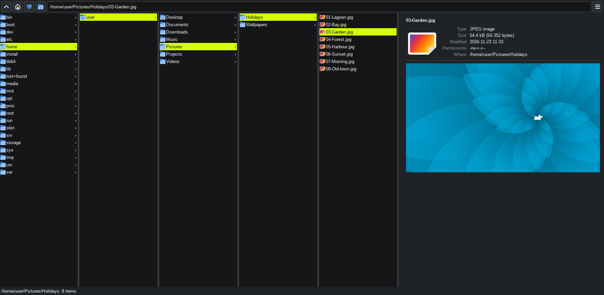
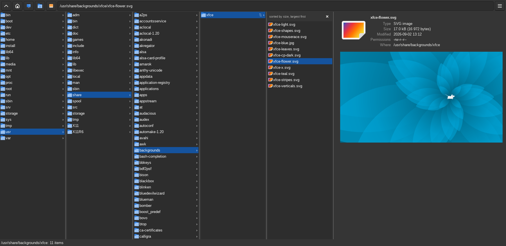

# Changelog

## 0.7.6 (2026-11-23)

- **Names under thumbnails on by default** (Settings → Look → Gallery). Your own choice, once saved,
  stays.

- **Search:** Ctrl+F (or Menu → Search here…) searches the current folder and every folder below
  it for names with the typed text in, upper/lower case alike. Results show up while it searches,
  nearest first, each with the folder it is in; the preview shows the one you pick, Enter or a
  double-click opens it in the columns, Escape goes back. Stops at 5000 (type more to narrow it
  down); never walks into /proc, /sys, /dev or /run from above.

- **Trash:** always the last line of the bookmarks menu (no ✕), its icon full or empty. Sorted by
  name; its buttons on top sort by size, newest or oldest deleted, and name again. It opens in a
  window of its own (close it and you are back where you were) and shows the trash of every
  disk; the preview says where an item was deleted from and when (and still shows pictures and
  text). Right-click: Put back (the folder is made again if it is gone; something new in its place
  asks skip / keep both / replace), Delete permanently (also the Delete key), Empty trash…
  Dropping files on it moves them to the trash.

- **"Show in folder":** while millerX runs it answers browsers' "Show in folder" (D-Bus
  org.freedesktop.FileManager1) when no other file manager does. It never pushes another one away;
  the README says how to make it the one D-Bus starts.

- **Thumbnail size:** Settings → Thumbnails → Size: small, medium (as before) or large, about 100,
  200 or 400 px. A narrow preview still shows them apart (at least 4, 3 or 2 per row). Large ones
  are made once at 512 px and kept in the shared cache. Asked for on LinuxQuestions.

- **Set default program:** Open with → Set default lists the same programs with the current one
  ticked; the one you pick opens that kind of file from then on. Saved in `~/.config/mimeapps.list`,
  which Thunar and the file dialogs read too. Picking a program in Open with alone changes nothing.

- **Checksums:** right-click a file → Checksums…: MD5, SHA-1 and SHA-256 in one read (with a bar for
  big files, stops when you close it), a Copy button each, and a Compare field for the checksum you
  were given (spaces, case and a file name after it don't matter). Asked for on LinuxQuestions.

- **Blender files:** `.blend` files show the picture Blender saves in them, through Blender's own
  `blender-thumbnailer`: from PATH, else `/opt/blender`, else the newest `/opt/blender-*` (by
  version: 4.10 is newer than 4.2). An optional helper like ffmpeg; without Blender nothing changes.
  Asked for on LinuxQuestions.

## 0.7.5 (2026-11-22)

- **Double-click runs programs:** a program you may run (the x bit, and really a program) starts in
  its own folder; a script asks first: Run, Run in terminal (which waits for Enter so you can read
  what it printed), or Open to read it; a launcher (.desktop with the x bit) starts what it
  describes. Before, millerX looked for "the program for this type" and found none. A file that only
  has the x bit, like everything on a FAT or NTFS stick, still just opens.

- **Disk fill bar in the highlight colour:** the Computer column's preview shows how full a disk is
  in your highlight colour (or the theme's), red above 95 %. GTK's own colours were made for
  batteries: an almost empty disk showed orange.

## 0.7.4 (2026-11-22)

- **Computer column:** the computer button (Alt+/) opens a first column with all your disks (also
  the ones from /etc/fstab), USB sticks and other removable media, network shares and GVfs places
  (sftp://, smb://), plus "Connect to server…". A disk opens to the right like any folder; the
  preview shows the disk itself (device, file system, free space, a fill bar) instead of counting it.
  One click mounts a stick, right-click ejects or unmounts it. The separate drive button is gone.

- **Thumbnails setting:** Settings → Thumbnails → Show: Not in network folders (the default now:
  NFS, Samba, sshfs get plain icons, so a slow share stays quick), Always, or Never (plain icons
  everywhere). A file you click is still shown big.

- **Settings in three tabs:** Look (dividers and highlight on the left, browsing and preview on the
  right), Thumbnails (what to show, the cache, the optional helpers) and Folders (the ones sorted their
  own way). Shorter, no scrolling; they open on the tab you used last.

- **Optional helpers can be switched off:** Settings → Thumbnails → Optional helpers has a tick box
  for each one that's installed. ffmpeg off: no video frames, music covers or AVIF/HEIC; pdftoppm off:
  no PDF pages; pkexec off: "Open as root" disappears from every menu.

## 0.7.2 (2026-11-21)

- **Column width setting:** Settings → Browsing → Column width (120–600, default 230) sets where new
  folder columns start. Open columns follow it at once; one you dragged keeps its own width, and
  double-clicking its divider brings it back to the setting.

## 0.7.1 (2026-11-21)

- **millerX remembers its window:** close it and open it again, and it comes back with the same size,
  in the same place, maximized if it was. If that place isn't on any screen any more (monitor
  unplugged), it opens centred. On Wayland only the size is kept: the compositor decides where windows go.
- **New windows** (Ctrl+N, middle-click) open centred and bigger, 1400 × 800 (at most 85 % of the
  screen), not wherever the window manager drops them. The very first start does the same.
- **Narrow preview:** when the pane gets narrow, the icon moves above the details, so they keep the
  whole width instead of breaking into a few letters per line. Wider again, it goes back beside them.
- **Settings in boxes:** every section has its own frame with its title on it, the labels line up
  across all of them, and the window scrolls if the screen is too small for it.

## 0.7 (2026-11-21)

The gallery (a folder's contents under its details) grew up:

- **Select several thumbnails**: Ctrl+click adds or removes one, Shift+click takes a range,
  Ctrl+A all of them. Right-click, Delete, Shift+Delete, Ctrl+C and Ctrl+X work on the whole
  selection; Rename and Properties on one. A plain click on one of several selected picks just
  that one.
- **Ctrl+C and Ctrl+X** on thumbnails, like in a column.
- **Drag thumbnails out**, one or the whole selection, like rows in a column: into Audacious, GIMP,
  a browser, another millerX window or a folder. The thumbnail goes along under the mouse.
  (Asked for on LinuxQuestions.)
- **Videos show a frame** (a few seconds in; very short ones their first frame) and **music files
  their embedded cover**, in the gallery and in the big preview, through ffmpeg if it is
  installed. Music without a cover keeps its icon and isn't asked again. Saved in the shared
  thumbnail cache like pictures.
- The right-click menu of thumbnails also offers **Compress…** and, for archives, **Extract**.
- **Settings → Optional helpers** shows which helper programs millerX found (ffmpeg, pdftoppm,
  pkexec), what each one gives, and what to install if one is missing. So no more wondering why
  pictures have thumbnails and videos don't.
- **A folder's details follow it:** size and item counts update when files are added, deleted
  or moved in or out while you look at it (they used to keep the old numbers).

## 0.6.5 (2026-11-21)

- **Archives: unpack and pack**, right in millerX, with libarchive (which millerX already used for
  the preview, so nothing new to install):
  - right-click an archive → **Extract here**: an archive with one folder (or file) on top puts
    just that next to it; one with several things on top gets its own folder, so nothing spills
    out. **Extract to "name/"** always makes a folder.
  - right-click files or folders → **Compress…**: pick a name and zip, tar.gz, tar.xz, tar.zst
    or 7z.
  - Runs in the background with the progress bar and Cancel; a cancelled or failed job leaves
    nothing half-done behind. Name conflicts ask, as with copying (skip, keep both, merge).
  - **Safe with hostile archives:** entries with absolute paths or `..` are left out (and you're
    told), and nothing is written through symlinks, so an archive can't put files outside the
    folder you unpack it in.
  - Reads zip, tar (gz, bz2, xz, zst, …), 7z, rar, cpio, iso, jar, cbz, epub and Slackware's
    txz/tgz packages. The preview now also lists 7z, rar and cpio contents.
- **Slackware: a ready-built .txz** on every release from now on, built on Slackware 15.0 (so it
  runs on 15.0 and -current). The SlackBuild is still there for building it yourself.

## 0.6.4 (2026-11-21)

- **New window**: Ctrl+N or Menu → New window opens a second window at the same folder;
  right-click a folder → *Open in new window*, or middle-click it. Handy for comparing two
  folders. (Idea from a LinuxQuestions user who asked for tabs.)

## 0.6.3 (2026-11-21)

- **Builds on Slackware 15.0 again** (and anything else with GLib 2.70 or newer).
  0.6.2 used thumbnail names that only came with GLib 2.76. Now millerX finds the
  cached thumbnails itself, the way the freedesktop standard describes, so it works the
  same everywhere. Thanks to random_guy and Paulo2 on LinuxQuestions for the report.

## 0.6.2 (2026-11-20)

- **Your own highlight colour** (Settings → Highlight colour). Click a swatch or pick any
  colour and the window shows it at once; the text on it turns dark or light by itself.
  "Follow the theme" brings back the theme's colour.
- **For all GTK programs too**, if you like: *Use for all GTK programs…* writes the colour
  into `~/.config/gtk-3.0/gtk.css`, in a block marked as millerX's. Everything else in that
  file stays as it is, and *Remove from all* takes only that block out again.
  Programs pick it up the next time they start.

## 0.6.1 (2026-11-20)

- **AVIF, HEIC and other pictures** that gdk-pixbuf can't read are shown through
  **ffmpeg**, if it is installed, in the preview and in the gallery.
- **Names under thumbnails** (Settings → Gallery): one line under each tile, cut in the
  middle so the extension stays visible (`a-very-lo…nal-v2.jpg`). Off by default.

## 0.6 (2026-11-20)

### The preview pane

- **Takes the rest of the window.** The columns get what they need, the preview gets
  everything else and follows the window when you resize it. The width in the settings
  (and dragging the pane's edge) is now its *minimum*.
- **New layout:** the file or folder icon on the left, name and details on the right,
  a line, then the picture, text or gallery underneath.
- **One picture always fits** the pane, and is never enlarged beyond its own size.
- **WebP** pictures work everywhere, decoded with libwebp (many systems' gdk-pixbuf has
  no WebP loader). Animated WebP still shows its icon.

### The gallery (a folder's contents)

- **More columns on wide panes** instead of ever bigger tiles (around 200 px each).
- **Opens at once, even with thousands of files:** every tile is created right away as an
  icon, and pictures are loaded only for what is on screen plus one page ahead,
  four at a time. Tiles you scroll past quickly are skipped and loaded when they come back.
  Up to 5000 files per folder.
- **PDFs show their first page.**
- **Right-click a thumbnail** for its own menu: open, open with, show in column, cut, copy,
  rename, move to trash, delete permanently, copy path, properties.
  Delete, Shift+Delete, F2, the Menu key and Alt+Enter work on a selected thumbnail too.
- **Follows its folder:** deleted and renamed files change in place, the gallery doesn't
  jump back to the top.
- **"Show in column"** selects the file in its column and scrolls it into view.

### Thumbnails

- Thumbnails are **saved to the shared cache** (`~/.cache/thumbnails`, the freedesktop
  standard), so the second visit is instant, and Thunar, file dialogs and millerX all
  use each other's thumbnails.
- **The cache is kept in check**, once a day when millerX starts: thumbnails of files that
  are gone (not of files on a drive that is just unplugged), thumbnails unused for 180 days,
  then the least used ones above 1 GB. All three can be changed in the settings, which
  also show the cache's size and have a **Clear…** button.

### Sorting per folder

Everything stays **sorted by name**, so your eye learns where things are. A folder that
should be different gets its own order: right-click it → **Sort "…"** → name, date modified
(newest first), size (largest first) or type, optionally reversed.

- A thin bar on top of its column says how it is sorted; its ✕ goes back to name.
- A faint ⇅ next to the folder's name in the column on its left.
- The gallery uses the same order.
- The settings list every folder with its own order, to change or remove it.

### Smaller things

- Opening millerX with a path scrolls to that row once the columns are laid out.
- Settings: the preview's width is labelled "Minimum width".

## 0.5.6 (2026-11-19)

- Pictures in the preview as big as the pane allows; small ones keep their size.
- Folders show their contents as a thumbnail grid under the details
  (background loading, reuses existing thumbnails; double-click opens).

## 0.5.5 (2026-11-19)

- Bookmarks and drives menus open at full size right away (no resize, no scrolling up).
- A small ✕ next to each bookmark removes it.

## 0.5.4 (2026-11-19)

- First public release.
