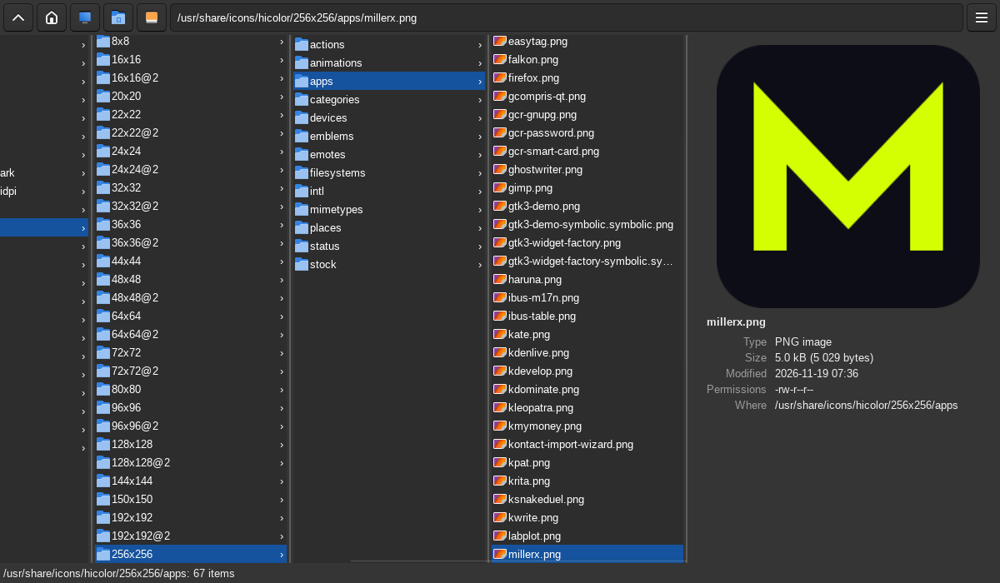

# millerX

A small, native file browser with **Miller columns**: every folder from `/` down to
where you are sits in its own column, and the selected file is previewed on the right.
Like a mind map of your disk. Written in C with GTK 3 and GIO.

> **New in 0.7.4:** the computer button opens a Computer column: all your disks with free space,
> USB sticks, network shares, "Connect to server…" · settings in three tabs · thumbnails not in
> network folders (or always / never) · optional helpers can be switched off.
>
> **New in 0.7.2:** Settings → Column width: where new folder columns start (default 230).
>
> **New in 0.7.1:** millerX remembers its window size and place · settings in tidy boxes ·
> a narrow preview stacks the icon above the details.
>
> **New in 0.7:** the gallery: select several thumbnails, drag them out, Ctrl+C/X · video
> frames and music covers (through ffmpeg).
>
> **New in 0.6.5:** extract and compress archives (zip, tar.gz/xz/zst, 7z) · a ready-built
> Slackware .txz on every release.
>
> **New in 0.6.4:** more windows: Ctrl+N, Menu → New window, or middle-click a folder.
>
> **New in 0.6.3:** builds on Slackware 15.0 (GLib 2.70) again.
>
> **New in 0.6.2:** your own highlight colour, picked live in the settings, and if you
> like for all GTK programs.
>
> **New in 0.6.1:** AVIF and HEIC pictures (through ffmpeg) · optional names under the
> gallery's thumbnails.
>
> **New in 0.6:** the preview takes the rest of the window and fits pictures into it ·
> a fast gallery of a folder's pictures and PDFs, with its own right-click menu ·
> thumbnails shared with Thunar in `~/.cache/thumbnails`, cleaned up automatically ·
> WebP pictures · sorting per folder (date, size, type), clearly marked.
> All the details: [CHANGELOG](CHANGELOG.md).

### Miller columns

Miller columns, also called *cascading lists*, show a tree one level per column:
pick a folder and its contents open in the next column to the right, while every
level above stays visible. You always see where you are and how you got there,
and moving up or sideways is a single click or arrow key.

The technique is credited to **Mark S. Miller**, who came up with it in 1980 at
Yale University; it was later used at Project Xanadu, Datapoint and NeXT.
millerX carries his name.



## What it does

- **Columns from `/`** to the current folder; ← → and the mouse move through them,
  the newest column always stays in view.
- **Preview** in the rest of the window: pictures (WebP, AVIF and HEIC too) fitted to the pane, a video's
  frame, a song's cover, the first
  page of PDFs, text, the contents of archives (zip, tar, 7z, rar, …), folder sizes counted in the background.
- **Gallery**: a folder's pictures and PDFs as thumbnails under its details. Opens at once
  even with thousands of files, loads only what is on screen, and right-click gives each
  thumbnail its own menu (open, show in column, rename, trash, …). Select several with
  Ctrl/Shift+click, drag them out or copy them like rows. Videos show a frame, music its cover. Names under the
  thumbnails if you like (one line, cut in the middle so the extension stays).
- **Shared thumbnail cache** (`~/.cache/thumbnails`, like Thunar and the file dialogs),
  cleaned up automatically: files that are gone, unused for 180 days, above 1 GB.
- **Sorting per folder**: everything is sorted by name, so your eye learns where things are.
  A folder can have its own order (date, size, type, reversed), shown by a bar on top of
  its column and a ⇅ next to its name.
- **Archives**: right-click → Extract here / Extract to "name/", or Compress… to zip, tar.gz,
  tar.xz, tar.zst or 7z. In the background, with Cancel; hostile archives can't write outside the
  folder.
- **Resizable columns**: drag a divider for long names, double-click for the default width.
- **More windows**: Ctrl+N, Menu → New window, or middle-click a folder. Copy, paste and
  drag & drop work between them, e.g. one window above the other to compare two folders.
- **Open, Open with, Open terminal here** (your `$TERMINAL`, or the first of 17 known terminals).
- **Cut, copy, paste**, compatible with Thunar's clipboard. A highlighted folder receives the paste.
- **Drag & drop**: same file system moves, otherwise copies; Ctrl copies, Shift moves.
- **Rename, new folder, move to trash, delete permanently**, with a conflict dialog
  (skip, keep both, replace or merge, "do this for all").
- **Bookmarks**, shared with Thunar and the GTK file dialogs.
- **Computer column** (the computer button, Alt+/): all your disks with free space and a fill bar,
  USB sticks (one click mounts, right-click ejects), network shares and GVfs places (sftp://,
  smb://), and "Connect to server…". A disk opens to the right like any folder.
- **Type to jump**: type the first letters of a name; the same letter again goes to the next match.
- **Properties** with editable permissions, free space and folder totals.
- **Open as root** through polkit (`pkexec`): the password is asked by your polkit agent,
  millerX never sees it. A root window shows a red warning bar.
- **Highlight colour** of your own, chosen live in the settings, for millerX or for every
  GTK 3 program (a marked block in `~/.config/gtk-3.0/gtk.css`, removable again).
- Columns follow changes on disk. Names sort case-insensitive and naturally (file2 before
  file10), folders first (optional).


What changed in each version: [CHANGELOG](CHANGELOG.md).

## Keys

| Key | Action |
| --- | --- |
| ← → | previous / next column |
| Backspace, Alt+↑ | up one level |
| Alt+Home, Alt+/ | home, file system root |
| Enter | open |
| F2 | rename |
| Delete, Shift+Delete | move to trash, delete permanently |
| Ctrl+C, Ctrl+X, Ctrl+V | copy, cut, paste |
| Ctrl+Shift+N | new folder |
| Ctrl+D | bookmark this folder |
| Ctrl+H | show hidden files |
| Ctrl+L | location bar |
| Alt+Enter | properties |
| Ctrl+N | new window at this folder |
| Ctrl+, | settings |
| F5 | reload |
| Ctrl+Q, Ctrl+W | close |

Middle-click a folder (or right-click → Open in new window) to open it in a second window.

In the gallery: Ctrl/Shift+click selects several thumbnails, Ctrl+A all. Enter opens one in its
column; Delete / Shift+Delete, Ctrl+C / Ctrl+X, F2, the Menu key and Alt+Enter work as in a column.

## What it needs

One program of about 170 KB. Everything it links is already on any desktop that runs
GTK 3 programs:

```
millerx
├── GTK 3            the window, columns and dialogs
│   └── GLib/GIO, Pango, Cairo, gdk-pixbuf   (come with GTK)
├── libarchive       looking into, unpacking and packing archives
└── libwebp          WebP pictures (optional: left out if it isn't there when building)
```

Programs it uses **if they are installed**, nothing breaks without them (Settings → Optional
helpers shows which ones it found):

| For | Program | Without it |
| --- | --- | --- |
| PDF previews | `pdftoppm` (poppler) | the PDF's icon |
| AVIF, HEIC and other pictures, video frames, music covers | `ffmpeg` | the file's icon |
| Open as root | `pkexec` + a polkit agent | no root window |
| USB sticks, Connect to server | gvfs / udisks2 | only disks already mounted |
| Open terminal here | any terminal (`$TERMINAL` or one of 17 known) | a message saying none was found |

No Qt, no KDE or GNOME libraries, no Python, no thumbnailer service, nothing running in
the background. It works with any window manager or desktop on X11.

## Install

Packages for **Slackware**, **Debian/Ubuntu** and **Arch** are attached to every
[release](https://github.com/overcatbe/millerx/releases).

- **Slackware**: the ready-built `millerx-*_SBo.txz` (built on 15.0, runs on -current too):
  `installpkg millerx-*.txz` as root. Or build it yourself: download the `.SlackBuild.tar.gz`
  and the source tarball, then as root:
  `./millerx.SlackBuild && installpkg /tmp/millerx-*_SBo.tgz`
- **Debian / Ubuntu**: `sudo apt install ./millerx_*.deb`
- **Arch**: `sudo pacman -U millerx-*.pkg.tar.zst`

### Build from source (any distro)

Needs GTK 3.22+, GLib/GIO 2.70+, libarchive, meson 0.60+ and ninja (on Slackware 15.0: with the
official patches, which bring meson 1.11). Optional: libwebp (WebP pictures;
found automatically when building), `pdftoppm` (poppler) for PDF previews, `ffmpeg` for
AVIF, HEIC and other pictures gdk-pixbuf can't read, polkit plus an
authentication agent for "Open as root".

```sh
meson setup build --prefix=/usr
ninja -C build
sudo ninja -C build install
```

## Settings

Menu → Settings (Ctrl+,), or `~/.config/millerx/millerx.conf`:

```ini
[look]
divider_color = auto     # auto = theme background 20 % lighter (dark) / darker (light), or #rrggbb
divider_width = 2        # 1-12
divider_style = solid    # solid | fade
preview_width = 340      # 200-900, the least the preview gets; it takes the rest
gallery_names = false    # a line with the name under each thumbnail
highlight_color = auto   # auto = the theme's, or #rrggbb
column_width = 230       # 120-600, where new folder columns start

[browse]
folders_first = true
show_hidden = false

[thumbnails]
show = local             # local (none in network folders) | always | never
max_mb = 1024            # cache size to shrink to, least used first
max_days = 180           # forget thumbnails unused this long
auto_clean = true        # once a day when millerX starts

[helpers]                # installed helpers can be switched off
ffmpeg = true            # video frames, music covers, AVIF/HEIC
pdftoppm = true          # PDF pages
pkexec = true            # "Open as root"

[window]                 # written by millerX: where the last closed window was
```

Folders with their own sorting are kept in `~/.config/millerx/sorting.conf`, one per line
(`date`, `size`, `type` or `name`, a tab, `1` if reversed, a tab, the folder). The settings
list them too, to change or remove.


## Bugs and wishes

Please open an [issue](https://github.com/overcatbe/millerx/issues).

## License

GPL-2.0-or-later, see [COPYING](COPYING).

Forks are welcome. The name "millerX" and the logo aren't part of the license: a changed
version needs another name and logo, see [NOTICE](NOTICE).
