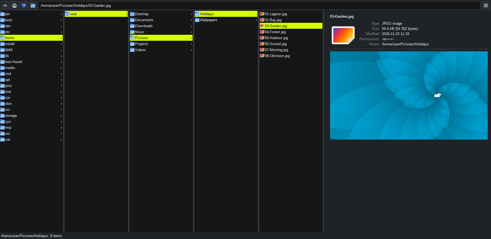
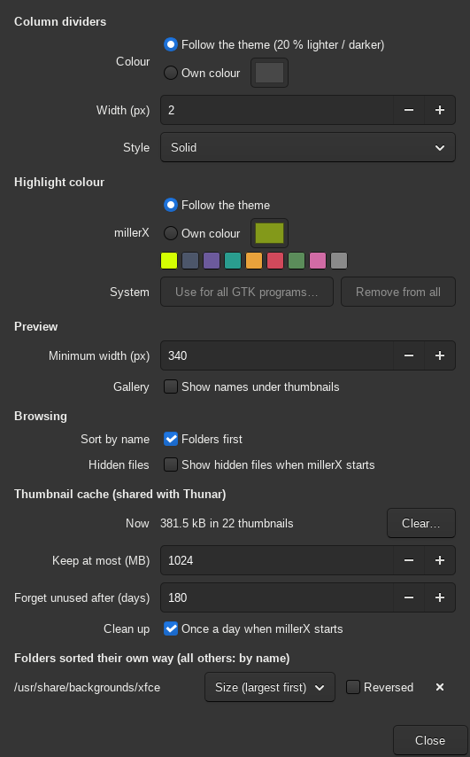

# millerX

A small, native file browser with **Miller columns**: every folder from `/` down to
where you are sits in its own column, and the selected file is previewed on the right.
Like a mind map of your disk. Written in C with GTK 3 and GIO.

> **New in 0.6.1:** AVIF and HEIC pictures (through ffmpeg) · optional names under the
> gallery's thumbnails.
>
> **New in 0.6:** the preview takes the rest of the window and fits pictures into it ·
> a fast gallery of a folder's pictures and PDFs, with its own right-click menu ·
> thumbnails shared with Thunar in `~/.cache/thumbnails`, cleaned up automatically ·
> WebP pictures · sorting per folder (date, size, type), clearly marked.
> All the details: [CHANGELOG](CHANGELOG.md).

### Miller columns

Miller columns, also called *cascading lists*, show a tree one level per column:
pick a folder and its contents open in the next column to the right, while every
level above stays visible. You always see where you are and how you got there,
and moving up or sideways is a single click or arrow key.

The technique is credited to **Mark S. Miller**, who came up with it in 1980 at
Yale University; it was later used at Project Xanadu, Datapoint and NeXT.
millerX carries his name.


## What it does

- **Columns from `/`** to the current folder; ← → and the mouse move through them,
  the newest column always stays in view.
- **Preview** in the rest of the window: pictures (WebP, AVIF and HEIC too) fitted to the pane, the first
  page of PDFs, text, the contents of zip/tar archives, folder sizes counted in the background.
- **Gallery**: a folder's pictures and PDFs as thumbnails under its details. Opens at once
  even with thousands of files, loads only what is on screen, and right-click gives each
  thumbnail its own menu (open, show in column, rename, trash, …). Names under the
  thumbnails if you like (one line, cut in the middle so the extension stays).
- **Shared thumbnail cache** (`~/.cache/thumbnails`, like Thunar and the file dialogs),
  cleaned up automatically: files that are gone, unused for 180 days, above 1 GB.
- **Sorting per folder**: everything is sorted by name, so your eye learns where things are.
  A folder can have its own order (date, size, type, reversed), shown by a bar on top of
  its column and a ⇅ next to its name.
- **Resizable columns**: drag a divider for long names, double-click for the default width.
- **Open, Open with, Open terminal here** (your `$TERMINAL`, or the first of 17 known terminals).
- **Cut, copy, paste**, compatible with Thunar's clipboard. A highlighted folder receives the paste.
- **Drag & drop**: same file system moves, otherwise copies; Ctrl copies, Shift moves.
- **Rename, new folder, move to trash, delete permanently**, with a conflict dialog
  (skip, keep both, replace or merge, "do this for all").
- **Bookmarks**, shared with Thunar and the GTK file dialogs.
- **Drives**: mount, open and eject USB sticks (through udisks2/gvfs).
- **Type to jump**: type the first letters of a name; the same letter again goes to the next match.
- **Properties** with editable permissions, free space and folder totals.
- **Open as root** through polkit (`pkexec`): the password is asked by your polkit agent,
  millerX never sees it. A root window shows a red warning bar.
- Columns follow changes on disk. Names sort case-insensitive and naturally (file2 before
  file10), folders first (optional).



What changed in each version: [CHANGELOG](CHANGELOG.md).

## Keys

| Key | Action |
| --- | --- |
| ← → | previous / next column |
| Backspace, Alt+↑ | up one level |
| Alt+Home, Alt+/ | home, file system root |
| Enter | open |
| F2 | rename |
| Delete, Shift+Delete | move to trash, delete permanently |
| Ctrl+C, Ctrl+X, Ctrl+V | copy, cut, paste |
| Ctrl+Shift+N | new folder |
| Ctrl+D | bookmark this folder |
| Ctrl+H | show hidden files |
| Ctrl+L | location bar |
| Alt+Enter | properties |
| Ctrl+, | settings |
| F5 | reload |
| Ctrl+Q, Ctrl+W | close |

On a selected thumbnail in the gallery: Enter opens it in its column, Delete / Shift+Delete,
F2, the Menu key and Alt+Enter work as in a column.

## Install

Packages for **Slackware**, **Debian/Ubuntu** and **Arch** are attached to every
[release](https://github.com/overcatbe/millerx/releases).

- **Slackware**: download the `.SlackBuild.tar.gz` and the source tarball, then as root:
  `./millerx.SlackBuild && installpkg /tmp/millerx-*.txz`
- **Debian / Ubuntu**: `sudo apt install ./millerx_*.deb`
- **Arch**: `sudo pacman -U millerx-*.pkg.tar.zst`

### Build from source (any distro)

Needs GTK 3, GLib/GIO, libarchive, meson and ninja. Optional: libwebp (WebP pictures;
found automatically when building), `pdftoppm` (poppler) for PDF previews, `ffmpeg` for
AVIF, HEIC and other pictures gdk-pixbuf can't read, polkit plus an
authentication agent for "Open as root".

```sh
meson setup build --prefix=/usr
ninja -C build
sudo ninja -C build install
```

## Settings

Menu → Settings (Ctrl+,), or `~/.config/millerx/millerx.conf`:

```ini
[look]
divider_color = auto     # auto = theme background 20 % lighter (dark) / darker (light), or #rrggbb
divider_width = 2        # 1-12
divider_style = solid    # solid | fade
preview_width = 340      # 200-900, the least the preview gets; it takes the rest
gallery_names = false    # a line with the name under each thumbnail

[browse]
folders_first = true
show_hidden = false

[thumbnails]
max_mb = 1024            # cache size to shrink to, least used first
max_days = 180           # forget thumbnails unused this long
auto_clean = true        # once a day when millerX starts
```

Folders with their own sorting are kept in `~/.config/millerx/sorting.conf`, one per line
(`date`, `size`, `type` or `name`, a tab, `1` if reversed, a tab, the folder). The settings
list them too, to change or remove.



## Bugs and wishes

Please open an [issue](https://github.com/overcatbe/millerx/issues).

## License

GPL-2.0-or-later, see [COPYING](COPYING).
